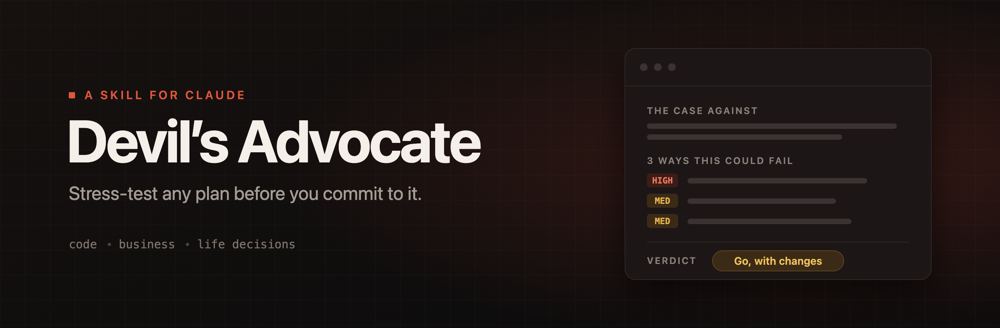

<p align="center">
  
</p>

<p align="center">
  <a href="https://github.com/Haseeb35/devils-advocate-skill/actions/workflows/validate.yml"></a>
  <a href="https://github.com/Haseeb35/devils-advocate-skill/releases/latest"></a>
  <a href="LICENSE"></a>
  
  
</p>

<p align="center">
  <a href="#installation">Installation</a> ·
  <a href="#modes">Modes</a> ·
  <a href="examples">Examples</a> ·
  <a href="#testing">Testing</a> ·
  <a href="CONTRIBUTING.md">Contributing</a>
</p>

---

Most plans fail for reasons that were visible in advance. Nobody looked, because the person making the plan was busy being excited about it.

**Devil's Advocate** is a skill for Claude that looks for you. Give it a plan — a migration, a product launch, a career move — and it argues the strongest honest case against it, names the most likely ways it fails, makes the best case *for* it, and then gives you a straight verdict.

It is deliberately not a pessimist. If your plan is sound, it says so.

<p align="center">
  
</p>

<p align="center"><sub>Real output, unedited. Full transcript in <a href="examples/standard-rest-to-graphql.md">examples/standard-rest-to-graphql.md</a>.</sub></p>

## Installation

### Claude Code (recommended)

```
/plugin install devils-advocate --marketplace Haseeb35/devils-advocate-skill
```

<details>
<summary>Older Claude Code versions, or manual install</summary>

On versions before 2.1.275, add the marketplace first:

```
/plugin marketplace add Haseeb35/devils-advocate-skill
/plugin install devils-advocate@devils-advocate
```

Or install the skill without the plugin system:

```bash
git clone https://github.com/Haseeb35/devils-advocate-skill.git
cp -r devils-advocate-skill/skills/devils-advocate ~/.claude/skills/
```

</details>

### Claude.ai

Download **`devils-advocate.zip`** from the [latest release](https://github.com/Haseeb35/devils-advocate-skill/releases/latest) and upload it under **Settings → Capabilities → Skills**.

## Usage

Just talk normally:

```
devil's advocate: we're moving the whole team to a 4-day week next month
```

```
poke holes in this — I'm raising prices 40% for new customers
```

The skill activates on phrases like *"poke holes in this"*, *"what could go wrong"*, *"am I crazy to…"*, *"should I really…"*, *"X or Y?"*, and when you're about to make a big, hard-to-reverse call: a rewrite, a stack choice, a launch, a hire, a resignation.

In a codebase, Claude reads the relevant code before arguing about it, so objections are grounded in what's actually there.

## Modes

The mode is picked from how you ask. You can also name it directly.

| Mode | Ask like this | You get |
|---|---|---|
| **Standard** | *"devil's advocate: …"* | The case against, 3 failure modes, the case for, a verdict |
| **Quick** | *"quick gut check: …"* | Biggest risk, best argument for, verdict — about five lines |
| **Deep** | *"do a deep pre-mortem on …"* | Hidden assumptions, 5 failure modes, a pre-mortem story, kill criteria |
| **Compare** | *"Postgres or MongoDB for …?"* | Each option critiqued, a side-by-side table, one pick |

Every failure mode comes with a **likelihood**, an **early warning sign** and a **way to prevent it**. Every response ends with one of four verdicts:

| | Verdict | Meaning |
|---|---|---|
| ✅ | **Go** | The plan holds up |
| ⚠️ | **Go, with changes** | Worth doing — fix these specific things first |
| 🔁 | **Rethink** | The goal is fine, but there's a clearly better route |
| ❌ | **Don't** | The risks outweigh the upside right now |

### Quick mode, real output

> **quick gut check:** should I buy the annual plan for our design tool instead of monthly? saves 20% and we've used it for 8 months

😈 **Biggest risk:** You pay for 12 months of seats up front, but most annual plans won't let you cut seats until renewal. If the team shrinks or you switch tools, the 20% you saved is gone.

**Best argument for:** You've used it for 8 months, so you clearly depend on it. Unless you'd drop it within roughly 10 months, annual comes out cheaper.

**Verdict: ⚠️ Go, with changes.** Buy annual, but only for the seats you're confident you'll still need in 12 months, and put the renewal date in your calendar.

**Ask yourself:** Is there any real chance you'll change tools or cut headcount in the next 10 months?

More in [`examples/`](examples), including a full [Compare mode run](examples/compare-postgres-vs-mongodb.md).

## Design principles

The skill is short, and most of it explains *why* rather than dictating rules.

- **Specific beats generic.** "The rewrite might take long" is noise. "Three developers and 40k lines means four to six months of frozen features" is a risk you can act on.
- **Every risk comes with a fix.** A warning sign and a prevention step turn criticism into a plan.
- **Fairness in both directions.** A critic who attacks everything is as useless as one who approves everything. The steelman and the honest verdict are what make the objections worth listening to.
- **Challenge the premise.** Sometimes the biggest risk is that the plan solves the wrong problem.
- **Tone follows stakes.** Technical decisions get blunt answers. Personal ones get the same honesty, delivered with care.

## Testing

The [`evals/`](evals) folder holds six test cases covering every mode, plus two behaviours that matter most: giving a fair **Go** to a sound plan, and asking questions when a plan is too vague to critique.

```bash
claude plugin eval .         # runs each case with and without the skill (billed model usage)
python3 scripts/validate.py  # structural checks, also run in CI
claude plugin validate .     # official plugin validation, also run in CI
```

## Project structure

```
.
├── .claude-plugin/      plugin and marketplace manifests, icon
├── skills/
│   └── devils-advocate/
│       └── SKILL.md     the skill itself
├── evals/               test cases for `claude plugin eval`
├── examples/            real and illustrative outputs
├── scripts/             validation and release tooling
└── assets/              banner, demo, social preview
```

## Contributing

Issues and pull requests are welcome. The most valuable contribution is a [report of a weak critique](https://github.com/Haseeb35/devils-advocate-skill/issues/new?template=weak-critique.yml) — a real decision where the skill was generic, unfair or wrong. See [CONTRIBUTING.md](CONTRIBUTING.md).

## License

[MIT](LICENSE)
